<p align="center"></p>

<p align="center">
  <a href="https://github.com/mrzroot/whycached/releases"></a>
  <a href="LICENSE"></a>
  
  
  <a href="https://github.com/mrzroot/whycached/commits"></a>
</p>

<p align="center"><a href="https://mrzroot.github.io/whycached/">Website</a> · <a href="README.fa.md">فارسی</a> · <a href="CHANGELOG.md">Changelog</a> · <a href="CONTRIBUTING.md">Contributing</a></p>

# whycached

**Deployed it, but still see the old version?** `whycached URL` finds *which* cache layer is serving it:
the CDN in front of your server, your own browser's HTTP cache, a service worker, or an asset file name that
never changes. It proves it by comparing what a normal request gets against what the origin really returns,
then prints the exact purge / hard-reload / unregister step for that layer.


English | [فارسی](README.fa.md)

```text
$ whycached https://shop.example.com/ --expect "v2"
whycached 0.1.0 · https://shop.example.com/
HTTP 200 · 56 bytes · sha e1ee030ec3f1 · layers: Cloudflare

STALE (1)

✗ shared · a shared cache (Cloudflare) is serving an older copy than the origin
    why:    the normal response (sha e1ee030ec3f1) differs from the cache-busted one (?_whycached=…, sha ede31a85ec4a)
            'v2' is MISSING in the normal response and present in the fresh one
            Age: 4120 = the copy you got is 68m 40s old
            Cloudflare: cf-cache-status: HIT
    fix:    Dashboard > Caching > Configuration > Purge Cache > Custom Purge > the URL
            curl -X POST ".../zones/$ZONE/purge_cache" ...
```

(Layout shortened. The real, unedited output of the offline demo is in [docs/demo.txt](docs/demo.txt); a run against a real
site, GitHub Pages, is in [docs/real-github-pages.txt](docs/real-github-pages.txt).)

## Why

"I pushed the fix and nothing changed" is rarely a code problem. There are four or five caches between
your commit and the pixel on screen, each with its own rules and its own way to clear it, and the symptoms look
identical. People (and AI coding agents) guess: redeploy, change the code again, hard-reload, wait. `whycached`
replaces the guess with an experiment: the same URL fetched four different ways, compared byte for byte.

Existing tools explain header files offline or simulate cache policy. `whycached` is the live one: point it at
the URL you are actually seeing and it tells you **which layer** is responsible (see [NOVELTY.md](NOVELTY.md) for
what was searched and what exists).

## Install

Python 3.9+, no dependencies. Tested on Linux; it is pure standard library, so macOS and Windows should work but are not tested yet.

```sh
pipx install git+https://github.com/mrzroot/whycached      # PyPI release not published yet
uvx --from git+https://github.com/mrzroot/whycached whycached --demo
pip install -e .                                           # from a clone
```

## Usage

```sh
whycached https://example.com/page                 # diagnose one URL
whycached https://example.com/ --expect "v2.4.1"   # a string that should be in the NEW version: turns a hint into a proof
whycached URL -H "Authorization: Bearer ..."       # extra request headers (repeatable)
whycached URL --no-assets                          # skip fetching linked CSS/JS
whycached URL -v                                   # show every probe
whycached URL --json                               # machine-readable
whycached --demo                                   # offline: a local server that behaves like 3 broken deployments
```

**Exit codes:** `0` nothing found · `1` something STALE or LIKELY · `2` could not fetch.

## What it does

For the URL it sends only `GET` requests (never purges or changes anything):

| Probe | What it tells |
|---|---|
| normal request, twice | headers, `Age`, `X-Cache` / `CF-Cache-Status` / `x-vercel-cache` / `Cache-Status` and the hit-miss transition between the two |
| same URL + `?_whycached=<nonce>` | a copy that (almost) never exists in a shared cache: close to what the origin serves now |
| normal URL + `Cache-Control: no-cache` request | makes a well-behaved cache revalidate |
| conditional request (`If-None-Match` / `If-Modified-Since`) | does the origin answer `304` |

Then it reasons per layer:

- **Shared cache (CDN / proxy), confirmed.** If the normal response differs from the cache-busted or no-cache one, or
  `--expect` is missing in the normal one but present in the fresh one, it is `STALE`, with the layer name, how old the
  copy is (`Age`), how long it stays fresh (`s-maxage`/`max-age`/`Expires`) and the vendor-specific purge command.
  Recognised: Cloudflare, Fastly, GitHub Pages, Vercel, CloudFront, Netlify, Akamai, Azure Front Door, Varnish,
  nginx/proxy caches, RFC 9211 `Cache-Status`, plain `Age`.
- **Your browser.** Computes private-cache freshness (including the 10 % heuristic when only `Last-Modified` is sent) and
  says how long a browser may legally reuse its copy without asking the server, with the hard-reload recipe.
- **Service worker.** Finds `serviceWorker.register(...)` in the HTML (or well-known `sw.js` names), reads the worker:
  Cache API / Workbox / cache-first, `skipWaiting`, cache names, and flags the classic bug of a worker script served with a
  long `max-age`.
- **Assets.** Linked same-origin CSS/JS cached for a day or more under a name with no hash or version.
- **Not a cache problem.** If `--expect` is in no response, it says so: deploy not finished or wrong environment.

Levels: `STALE` = confirmed by evidence, `LIKELY` = a legitimate reason your browser can show the old copy,
`NOTE` = worth knowing, `OK`.

### Use it as a step for agents

Paste [docs/AGENTS.snippet.md](docs/AGENTS.snippet.md) into `AGENTS.md` / `CLAUDE.md` / Cursor rules so that an agent runs
`whycached` before it "fixes" code that is already correct.

## Limits (please read)

- It cannot see inside your browser. Browser and service-worker findings are **reasons it can happen**, never proof that your
  tab is stale. A hard reload or private window settles it.
- The cache-busted request is not guaranteed to reach the origin. Some CDNs ignore query strings in the cache key; then a
  difference may be hidden. The `no-cache` probe and `--expect` are independent cross-checks.
- Per-user, per-region and per-device caches (CDN POPs, `Vary`, cookies) may differ from what this machine sees.
- Redirect chains are followed; login-protected pages need `-H`.
- Header signatures reflect public vendor behaviour as of October 2026 and may drift.

## Development

```sh
pip install -e ".[test]" && pytest     # 31 tests, local server only, no internet
```

MIT licensed · by [Mohammadreza Zare (mrzroot)](https://github.com/mrzroot) · landing page: https://mrzroot.github.io/whycached/

## Contributing

Bug reports and ideas are welcome: open an [issue](../../issues/new/choose) (the templates ask for the steps and version we need). For code, read [CONTRIBUTING.md](CONTRIBUTING.md) first, keep each pull request to one change, and run the tests before you open it.

## License

MIT, see [LICENSE](LICENSE).
